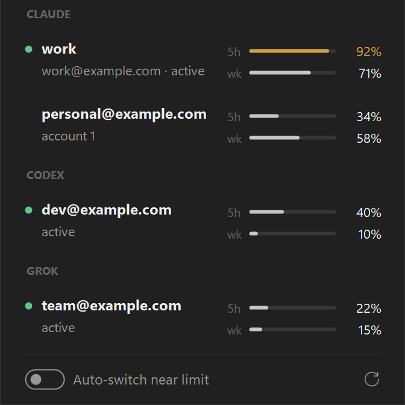

# handoff

**Your Claude accounts. One coding team.**

handoff turns your Claude Code accounts into a coordinated coding team. a Director plans the work; agents build, test, review, and open pull requests on your other accounts. you review and merge.

```text
Director  ->  coding agents  ->  verification + review  ->  GitHub pull request
plans         one isolated       your test command,         pushed and opened by handoff.
the work      worktree each      then a fresh reviewer      you merge. agents never do.
```

## how it works

1. you set a goal or point agents at a repository's open issues.
2. a read-only Director on Opus plans the next steps, orders them by dependency, and picks a model and effort for each. plain issues get a short Sonnet pass that orders and routes them instead.
3. each step runs in its own git worktree and branch, as one of your other Claude accounts.
4. handoff runs your verification command, then a fresh read-only session reviews the change. problems go back to the same session.
5. handoff pushes the branch and opens a pull request. failing checks, conflicts, and review comments get another pass.

## what you get

- **autonomous issue handling**: works through actionable issues you opened or are assigned to, one reviewed pull request each.
- **goal planning**: "the app has a settings page; `npm test` must pass". a goal counts as achieved only on evidence: merged work and passing checks.
- **cross-repository coordination**: a goal can plan steps in your other repositories, and a step can wait for one in another.
- **dependency ordering**: steps wait for the ones they build on to be merged.
- **adaptive routing**: Haiku, Sonnet, or Opus, and low to max effort, chosen per run and raised only when reviews or checks fail.
- **optional Ultracode**: off until you turn it on in settings, then used only on an idle account with plenty of quota.
- **account and quota routing**: each run goes to an account with room in that model's own weekly window, and waits when none has (Opus work falls back to Sonnet at high effort or more).
- **resumable, isolated work**: worktrees, branches, and sessions survive restarts, crashes, and pauses.

details, limits, and costs: [docs/agents.md](docs/agents.md).

## quick start

needs **Windows 11 (64-bit)**, [Claude Code](https://docs.anthropic.com/en/docs/claude-code) with auto mode, [Git for Windows](https://git-scm.com/download/win), and the [GitHub CLI](https://cli.github.com/) signed in (`gh auth login`). agents run on Claude accounts other than the one you're signed in with. with only one account they share it instead: they queue while your own terminals are working or the account is near its limit, and never close a session of yours.

1. download `handoff-win-x64.zip` from the [latest release](https://github.com/trexchery/handoff/releases/latest), extract it, and run `handoff\handoff.exe`.
2. open the tray icon, use **+** to add each Claude account through official CLI sign-in.
3. click the agents button (bottom right of the flyout) and pick your repository. a Claude Code terminal opens there.
4. type your first goal:

   ```text
   goal: the app has a settings page; `npm test` must pass
   ```

   or, for existing issues: *"work through the open issues; `npm test` must pass"*.
5. confirm the handoff dialog. it shows the branch pull requests target and the exact verification command.

ask the same terminal what's going on, to reorder or skip work, or to answer a question. agents run **only while that repository's terminal is open**: close it and they pause where they are, reopen it and they continue. nothing runs in the background.

## also in handoff

<p align="center">
  
</p>

- **usage dashboards**: 5-hour and weekly limits and reset times for every Claude, Codex, and Grok Build account in one tray window.
- **account switching**: one click, without closing running sessions. optional auto-switching near a limit (off by default, Claude only).
- **pinned terminals and project folders**: a terminal stays on its account, and a folder can be assigned an account without changing your login.
- **session handoffs**: **continue in...** starts a new CLI session with local notes after an interruption.

## good to know

- **you approve.** the dialog above gates agents; a change is held for you after two review passes still find problems or when it touches `.github/`; questions are posted on the issue. agents never merge, close issues, deploy, or change settings and secrets.
- **only your issues.** issues from strangers are never picked up, and only comments from you or the repository's owners, members, and collaborators count.
- **agents don't push.** their environment has no GitHub login; handoff pushes after verification and review. sessions run as your Windows user, so this prevents mistakes, not a determined program.
- **terms apply.** Anthropic's consumer terms (§3) restrict automated or scripted subscription access, so whether to run agents (or the optional auto-prime) on your accounts is your call. agents skip API-key accounts and stop before a subscription with extra usage on reaches the switch threshold.
- **providers.** agents use Claude Code only. Codex and Grok Build appear in the dashboard and switcher; Grok Build has only been tested with synthetic data.
- **credentials stay local.** saved logins are encrypted with Windows DPAPI. no telemetry, cloud sync, or browser-cookie access. releases are unsigned, so SmartScreen may warn; a `.sha256` checksum ships with the download. [SECURITY.md](SECURITY.md).

## build from source

requires [uv](https://docs.astral.sh/uv/), the [.NET 8 SDK](https://dotnet.microsoft.com/download/dotnet/8.0), and PowerShell 7.

```powershell
git clone https://github.com/trexchery/handoff.git
cd handoff
pwsh dock\build.ps1
```

built on [claude-swap](https://github.com/realiti4/claude-swap) by Onur Cetinkol. handoff additions by trexchery. [MIT license](LICENSE). independent project, not affiliated with Anthropic, OpenAI, or xAI.
