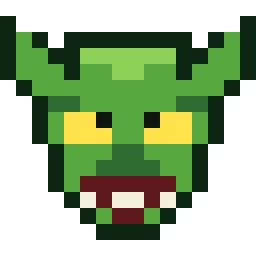
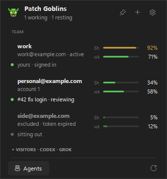

<p align="center">
  
</p>

<h1 align="center">Patch Goblins</h1>

<p align="center"><b>Your Claude accounts. One coding team.</b></p>

Patch Goblins turns your Claude accounts into a goblin team that keeps coding. each account is a goblin: the tray shows what every one is doing, how much quota it has left, and what it is working on. a Director plans the work; agents build, test, review, and open pull requests on your other accounts. you review and merge.

<p align="center">
  
</p>

```text
Team          ->  Work                                    ->  Upkeep
your accounts     Director plans, agents build in            keeps the team going when
as goblins        isolated worktrees, verification +         accounts hit their limits.
                  review, then a pull request you merge.
                  agents never do.
```

## how it works

**team.** every Claude account you add is a goblin on the team. the tray flyout lists them as a roster: each card shows the account, its 5-hour and weekly quota meters, and a one-line job with a colored dot.

- green: `yours · signed in` or `yours · terminal open` (your own login and terminals), or a run on it, like `#42 fix login · reviewing`.
- amber: `resting · back in 2h 10m` (near its limit or just yielded).
- grey: `idle`. quiet reasons show too, like `sitting out` (excluded) or `needs a login`.

the header shows the goblin, "Patch Goblins" and a live status line such as `2 working · 1 resting · 3 queued` (or `N need you`). switching accounts is one click and never closes running sessions. pinned terminals and project folders (assign a folder to an account without changing your login) live here too. Codex and Grok Build accounts are **visitors**: a collapsed row in the flyout (click to open) with their usage meters and manual switching. agents never use them.

**work.** the agents.

1. you set a goal or point agents at a repository's open issues.
2. a read-only Director on Opus plans the next steps, orders them by dependency, and picks a model and effort for each. plain issues get a short Sonnet pass that orders and routes them instead.
3. each step runs in its own git worktree and branch, as one of your other Claude accounts.
4. Patch Goblins runs your verification command, then a fresh read-only session reviews the change. problems go back to the same session.
5. Patch Goblins pushes the branch and opens a pull request. failing checks, conflicts, and review comments get another pass.

**upkeep.** what keeps the team running when accounts hit limits: auto-switch near a limit (off by default, Claude only), Auto-Prime (starts fresh 5-hour windows early, also automatically while agents run), quota notifications, and resuming stopped windows. agents already route by quota and give way to your own terminals.

## what you get

team

- **usage meters**: 5-hour and weekly limits and reset times for every Claude account on the team, and for Codex and Grok Build visitors.
- **one-click switching**: without closing running sessions.
- **pinned terminals and project folders**: a terminal stays on its account, and a folder can be assigned an account without changing your login.

work

- **autonomous issue handling**: works through actionable issues you opened or are assigned to, one reviewed pull request each.
- **goal planning**: "the app has a settings page; `npm test` must pass". a goal counts as achieved only on evidence: merged work and passing checks.
- **cross-repository coordination**: a goal can plan steps in your other repositories, and a step can wait for one in another.
- **dependency ordering**: steps wait for the ones they build on to be merged.
- **adaptive routing**: Haiku, Sonnet, or Opus, and low to max effort, chosen per run and raised only when reviews or checks fail.
- **optional Ultracode**: off until you turn it on in settings, then used only on an idle account with plenty of quota.
- **account and quota routing**: each run goes to an account with room in that model's own weekly window, and waits when none has (Opus work falls back to Sonnet at high effort or more).
- **resumable, isolated work**: worktrees, branches, and sessions survive restarts, crashes, and pauses.
- **session handoffs**: **Continue interrupted work** starts a new CLI session with local notes after an interruption.
- **new agent**: a plain Claude Code session in a general folder, on your default login.

upkeep

- **auto-switch, Auto-Prime, notifications**: auto-switch is switched on or off in settings under Upkeep, or in the tray menu's Upkeep group.

settings has three sections: Team, Work, Upkeep. the tray icon's right-click menu is grouped under the same three headers. one green, the goblin's, is the accent everywhere.

details, limits, and costs: [docs/agents.md](docs/agents.md).

## quick start

needs **Windows 11 (64-bit)**, [Claude Code](https://docs.anthropic.com/en/docs/claude-code) with auto mode, [Git for Windows](https://git-scm.com/download/win), and the [GitHub CLI](https://cli.github.com/) signed in (`gh auth login`). agents run on Claude accounts other than the one you're signed in with. with only one account they share it instead: they queue while your own terminals are working or the account is near its limit, and never close a session of yours.

1. download `patch-goblins-win-x64.zip` from the [latest release](https://github.com/trexchery/patch-goblins/releases/latest), extract it, and run `patch-goblins\patch-goblins.exe`.
2. open the tray icon, use **+** to add each Claude account through official CLI sign-in. that is your team.
3. click the **Agents** button (labeled, bottom left of the flyout) and pick your repository the first time. a Claude Code terminal opens there, themed green and labeled `Patch Goblins · agents`. later clicks reopen it for your last repository.
4. type your first goal:

   ```text
   goal: the app has a settings page; `npm test` must pass
   ```

   or, for existing issues: *"work through the open issues; `npm test` must pass"*.
5. confirm the Patch Goblins dialog. it shows the branch pull requests target and the exact verification command.

ask the same terminal what's going on, to reorder or skip work, or to answer a question. agents run **only while that repository's terminal is open**: close it and they pause where they are, reopen it and they continue. nothing runs in the background.

right-click the **Agents** button for **New agent**, per-repository pause, resume and stop, and an agents terminal in another folder. the tray icon's menu has the same under Work.

upgrading from handoff, Autodock, or ClautoSwap: quit the old tray and run the new exe once. your settings, agents, worktrees, project folders, and autostart carry over, and your saved logins stay where they are.

## good to know

- **you approve.** the dialog above gates agents; a change is held for you after two review passes still find problems or when it touches `.github/`; questions are posted on the issue. agents never merge, close issues, deploy, or change settings and secrets.
- **only your issues.** issues from strangers are never picked up, and only comments from you or the repository's owners, members, and collaborators count.
- **agents don't push.** their environment has no GitHub login; Patch Goblins pushes after verification and review. sessions run as your Windows user, so this prevents mistakes, not a determined program.
- **terms apply.** Anthropic's consumer terms (§3) restrict automated or scripted subscription access, so whether to run agents (or the optional auto-prime) on your accounts is your call. agents skip API-key accounts and stop before a subscription with extra usage on reaches the switch threshold.
- **providers.** agents use Claude Code only. Codex and Grok Build accounts are visitors: usage meters and manual switching only. Grok Build has only been tested with synthetic data.
- **the terminal's look.** the agents terminal uses a session-only Patch Goblins theme (green accents, a `Patch Goblins` status line) and never touches your own theme or settings. In that terminal a green pixel goblin takes the place of Claude Code's mascot: its pixels are hardcoded (only their color is a theme token, and no plugin hook draws the header), so Patch Goblins preloads a small script into that one session (`BUN_OPTIONS=--preload`, which Claude Code's Bun runtime reads) that swaps the mascot's glyph rows for the goblin's on their way to the screen. Nothing of Claude's is modified or installed; the script lives beside the session's other files. Terminals open in Windows Terminal running PowerShell 7 (else Windows PowerShell, else cmd).
- **credentials stay local.** saved logins are encrypted with Windows DPAPI. no telemetry, cloud sync, or browser-cookie access. releases are unsigned, so SmartScreen may warn; a `.sha256` checksum ships with the download. [SECURITY.md](SECURITY.md).

## build from source

requires [uv](https://docs.astral.sh/uv/), the [.NET 8 SDK](https://dotnet.microsoft.com/download/dotnet/8.0), and PowerShell 7.

```powershell
git clone https://github.com/trexchery/patch-goblins.git
cd patch-goblins
pwsh dock\build.ps1
```

built on [claude-swap](https://github.com/realiti4/claude-swap) by Onur Cetinkol. Patch Goblins additions by trexchery. [MIT license](LICENSE). independent project, not affiliated with Anthropic, OpenAI, or xAI.
